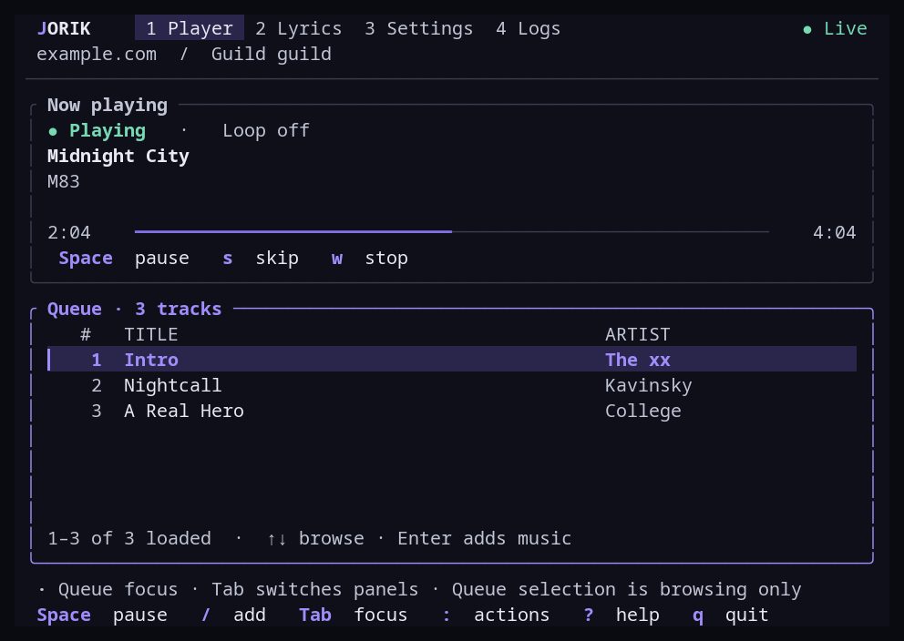

<div align="center">

</img>

under development  
powerful "remote" for Jorik Systems based Snail bot (also WIP)

</div>

## Releases

The stable release is **0.4.2**. This development branch is **0.5.0-dev.1**, not yet released.
See [CHANGELOG.md](CHANGELOG.md) for implemented hardening and remaining release-validation gates.

## Installing 0.5 builds

Until an attested 0.5 release exists, build this development branch with
`cargo build --release --locked`. The hardened bootstrap intentionally refuses
older, unattested releases; it never falls back to running a downloaded script.

From a trusted local checkout, once a 0.5 release is published:

```sh
bash installer/install.sh --tag v0.5.0 --dest "$HOME/.local/bin/jorik"
# Explicit prerelease opt-in:
bash installer/update-prerelease.sh
```

The Linux x86_64 GNU bootstrap requires Python 3 and a current, authenticated
[GitHub CLI](https://cli.github.com/) (`gh auth login`, or a GitHub-specific
`GH_TOKEN`). It verifies the package hash and signed build provenance before
staging a validated ELF and atomically replacing the destination. The default
destination is `~/.local/bin/jorik`; it never invokes sudo. Publisher/host overrides
and `curl | bash` installation are unsupported.

## Interactive player



*Deterministic UI preview with sample data; no live account or server content.*

The 0.5 player uses layered dark surfaces, rounded panels, readable title/artist
columns, explicit focus rings, and context-aware keyboard hints. Wide terminals
also show the spectrum; compact terminals prioritize playback and queue browsing.
Dialogs keep your place in the underlying screen and return there when dismissed.
Small text uses higher-contrast colors; the welcome screen keeps migration details
under `?` help rather than replacing the sign-in instructions.

```sh
cargo run -- tui
# Or, with an installed binary:
jorik tui
```

Log in with Enter when prompted, or run `jorik auth login` first.
The default API/webhook server is `https://jorik.gleckson.com`.
Override it with `--base-url`, `JORIK_BASE_URL`, or TUI settings.
Saved settings pointing to the retired `jorik.xserv.pp.ua` default are migrated
on load; custom hosts and explicit overrides remain unchanged.

The header shows the server, guild, and WebSocket status; REST remains the fallback.

### Controls

| Key | Action |
| --- | --- |
| Space / p | Pause or resume |
| / / Enter | Add a track or URL |
| Tab / Shift+Tab | Switch playback and queue focus |
| ↑↓ / j k | Select and scroll queue rows |
| PageUp / PageDown, Home / End | Page through the queue, or jump to its ends |
| : / Ctrl+p | Search all actions |
| ? | Keyboard help |
| s / w / l | Skip / stop / cycle loop mode |
| c | Clear queue, with explicit confirmation |
| v | Toggle visualization |
| 1 / 2 / 3 / 4 | Player / lyrics / settings / diagnostics |
| r | Refresh queue, or refresh lyrics on the lyrics screen |
| u | Review an available update |
| Esc | Cancel editing, close a dialog, or dismiss a notification |
| q / Ctrl+c | Quit; q remains text in input fields |

Track input supports cursor movement, Home/End, Delete/Backspace, bracketed paste,
and Ctrl+u to clear. Settings text fields support the same cursor editing and
paste behavior; Enter saves and Escape discards the draft. Appearance changes
preview and save immediately. Blank track submissions stay open with inline
feedback instead of silently closing. Lyrics support PageUp/PageDown, Home/End,
and refresh, and are invalidated when the track changes.

The player adapts to the terminal: an 80×24 window prioritizes playback and queue;
wide, tall windows can also show visualization. Zen remains a presentation mode;
switching focus to the queue makes queue navigation visible again. Visualization
visibility is a session preference; theme and layout settings remain persistent.

Queue selection currently navigates the loaded rows; it does not play, remove,
or reorder tracks. Updates appear as dismissible notices rather than interrupting
the active screen. Tab now changes focus; use `:` for the former menu.

## Authentication: 0.5 development

Saved credentials use **Windows Credential Manager**, **macOS Keychain**, or an
unlocked **Secret Service** provider on Linux. The provider must be available;
there is no automatic plaintext fallback. On headless systems, supply
`JORIK_TOKEN` through your environment/secret manager instead. Explicit
`JORIK_TOKEN` / `--token` overrides are not persisted. Avoid placing real tokens
in command history or sharing login URLs.

Credentials are scoped to the canonical server URL, including scheme, port and
API base path. Changing hosts drops the active token and cached player data
before looking up the new host's own credentials. Non-loopback servers require
HTTPS; local HTTP development servers remain supported. API redirects are not
followed automatically. WebSocket bearer tokens use the Authorization header,
never a query parameter.

### Upgrading from 0.4.x

The TUI shows a brief notice when older login files exist. Press `?` on the
sign-in screen for migration options, or press Enter for a fresh browser login.
A fresh login leaves those older files untouched.

Old `auth.json` files did not identify their server. They are **never reused or
migrated automatically**, even for the public server. Confirm the server that
issued the token explicitly:

```sh
jorik auth migrate --confirm-server https://jorik.gleckson.com
```

Migration verifies the OS-store write before deleting the legacy files. It
retains plaintext files on failures and refuses to overwrite a different scoped
credential. A fresh `auth login` is also possible, but does not silently erase old
unscoped credentials. If those files are obsolete, remove them deliberately:

```sh
jorik auth clear-legacy --confirm
```

Clearing legacy files is irreversible and does not require a working OS store
or valid server settings. `auth signout` removes only the selected server's
scoped credential and separately attempts remote revocation; other servers and
unscoped legacy files are untouched.

### Browser callback

The authorization endpoint remains `https://jorik.gleckson.com/authorize`.
The local return address is a fresh
`http://127.0.0.1:<port>/oauth-callback/<nonce>` for every login, not a public
callback URL. Request size, connection reads, replies and the overall 120-second
browser wait are bounded. Invalid requests do not consume the session. Use Ctrl+C
(CLI) or Escape (TUI) to cancel a pending login.

**CLI 0.5 requires the paired backend protocol; there is no bearer-query fallback.**
The CLI sends an S256 PKCE challenge and receives only a one-time code at
loopback. It exchanges that code and its private verifier at
`POST /oauth/cli/exchange` over HTTPS (HTTP is allowed only for loopback development).
Bearer credentials arrive in a bounded, validated JSON body, never in the
browser return URL.

The paired backend change is on `security/cli-oauth-0.5.0` in the bot repository.
It validates one-time Discord OAuth state and an independent HttpOnly browser
cookie, using Secure host-only `__Host-` cookies in production. CLI codes expire
after 60 seconds and can be redeemed once with the correct verifier. New user
tokens expire after 30 days. This is native-grant PKCE, not a claim that Discord
itself supports PKCE. Register the public **backend** `/oauth/callback` URL in the
Discord Developer Portal, not the ephemeral CLI address.

Callback pages contain no third-party resources, disable caching/referrers and
remove sensitive queries from the address bar. Backend rollout and live Discord
consent/cancel/retry validation are still required before release. A successful
local protocol test with a fake Discord identity does not prove deployed OAuth.

An opt-in native-store test creates and removes a random test-only credential.
Run it only with an unlocked OS store; normal tests use an isolated fake store:

```sh
cargo test --locked credentials::tests::native_credential_store_round_trip -- --ignored
```

## Verified updates

Updates require confirmation. The updater re-fetches metadata for the exact
selected GitHub release tag and accepts only the matching platform asset from
`fireflyteam/jorik-cli`. It checks the declared size and GitHub API SHA-256 digest
before extracting or launching anything. Missing digests, mismatched hashes,
unexpected URLs/redirects, oversized downloads, and malformed archives abort the
update. A current authenticated GitHub CLI must also verify Sigstore build
provenance pinned to this repository, `.github/workflows/build.yml`, the exact
release tag, GitHub's OIDC issuer and GitHub-hosted runners. Verification failures
or an unavailable verifier abort; there is no hash-only or remote-shell fallback.
Jorik credentials are not passed to the verifier.

- **Linux x86_64 GNU:** a single regular `jorik` ELF binary is staged beside the
  installed executable, synced, and atomically renamed into place. Validation or
  staging failures leave the installed file untouched. The installation directory
  must be writable; the updater never invokes sudo. Permission failures show a
  version-pinned manual release URL. Restart Jorik after installation.
- **Windows x86_64 MSVC:** the version-matching installer is verified in a private
  temporary directory, then launched directly for the existing installation
  directory. Jorik exits to let installation finish. This requires the installed
  `jorik.exe`, not a development `jorik-cli.exe`. The verified installer directory
  is printed and retained for the installer; it can be removed after it finishes.
- Other targets require manual installation. Stable versions do not automatically
  offer prereleases; prerelease versions may advance to newer prereleases or stable
  releases. Same-version reinstalls and downgrades are rejected.

**Trust boundary:** SHA-256 metadata comes from the GitHub release API. Signed
provenance additionally binds the package to the trusted workflow and exact tag;
hash metadata alone is insufficient. This still trusts GitHub Actions/OIDC,
Sigstore, the installed `gh` verifier, and the publisher's source/dependencies.
It is not an independent offline publisher key, reproducible-build proof, or
Windows Authenticode signature.

Release CI pins action commits, rejects mismatched package/tag versions, gates
builds on Linux/Windows/macOS checks, signs all published packages, verifies the
signatures before publication, and publishes `*.sigstore.json` bundles alongside
`SHA256SUMS`. Historical 0.4.2 assets predate this provenance requirement.

## Untrusted output and transport

API response bodies are bounded to 1 MiB even without Content-Length; WebSocket
frames/messages are bounded to 4 MiB. Server text is scrubbed of terminal control
sequences and bidi overrides before display, known credentials are redacted,
secret JSON fields are hidden, and diagnostic entries are bounded. These are
defense-in-depth measures, not a reason to trust arbitrary servers with a token.

## Checks

```sh
cargo test --locked
cargo fmt --all -- --check
cargo clippy --locked --all-targets -- -D warnings
python3 -B -m unittest discover -s installer/tests -v
bash -n installer/install.sh installer/update-prerelease.sh
```

CI also exercises native stores on Linux, Windows and macOS; Linux unavailable-store
behavior is tested against a deliberately missing DBus session. Locked native
stores and actual Discord/browser behavior still need operator validation.

With the paired backend checkout and Bun available, run its isolated protocol fixture:

```sh
JORIK_OAUTH_FIXTURE=/absolute/backend/checkout/scripts/cli-oauth-fixture.ts \\
  cargo test --locked auth::tests::paired_backend_pkce_round_trip -- --ignored
```

Optional historical-release verification downloads 0.4.2 into temporary files,
checks its hash and archive, then deletes it. It never runs or installs the binary
and does **not** test the new signed-provenance requirement:

```sh
cargo test --locked updater::tests::published_release_verifies_without_installing -- --ignored
```
