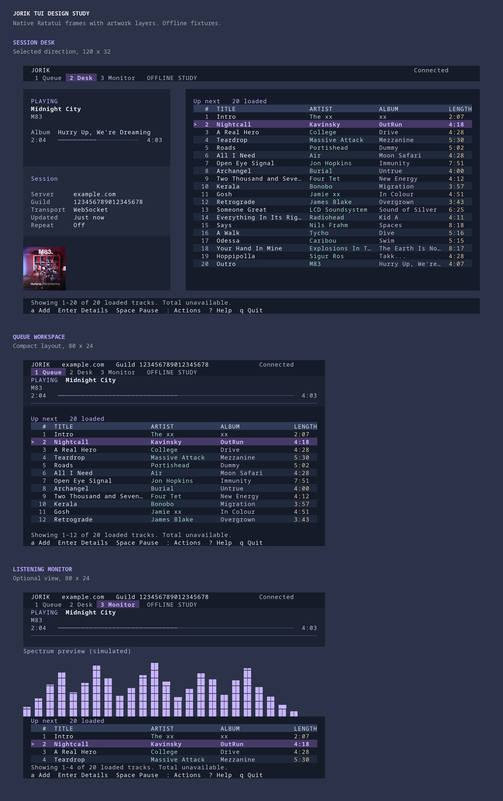

# Jorik TUI: research and proposed implementation

Research date: 3 November 2026. Scope: this checkout's Rust/Ratatui client for a shared Discord music bot.

**Integration status:** Desk is now implemented in the live `jorik tui` player, including the approved backgrounds, padding, tracklist colors, metadata columns, track details and antialiased artwork. The code audit below describes the initial implementation before integration. A subsequent hardening pass implements correlated/coalesced queue reads, independent operation state, recoverable Add music submissions, confirmed repeat state, playback freshness, server paging, non-blocking recovery, bounded grapheme-aware input, monochrome rendering and adaptive redraws. Runtime metadata follows the backend response, with explicit fallbacks. Inspection of the paired backend confirmed `thumbnail`, `durationMs` and queue totals, but no album field in its current queue serializer.

Integration and hardening verification: 137 Rust tests passed, 4 optional tests ignored; formatting, strict Clippy across all targets, and executable build passed. The compiled app was checked in color and monochrome PTYs for Desk rendering, focus/details, real queue offsets, bracketed paste, failed-query recovery, Settings/Help/Escape, 24×8 and 120×32 resizing, quitting, Ctrl+C and terminal restoration, using isolated configuration and a loopback API fixture rather than a live account. PTY testing exposed an orphaned stdin reader after a timed-out library artwork probe; production now uses non-reading detection, with half-block fallback and an explicit renderer override. Production snapshots are available at [80×24](assets/tui-player.png), [120×32](assets/tui-player-wide.png), and [120×50](assets/tui-player-tall.png).

**Selected direction: Session desk.** Playback, album and session details live on the left, with album artwork anchored at the bottom left; the queue takes the remaining width and includes album and song length. The playing song's duration appears beside its progress bar, without a duplicate Length entry. Desk keeps both columns at 80×24 and above. Smaller terminals use the compact queue layout. Keep Jorik's violet accent and the spectrum as an optional listening view. Implement reliable state and feedback before the visual pass.

Text hierarchy uses placement and alignment. Artist, repeat mode, server, guild, transport and freshness each have their own role and location. Do not join them with decorative slashes or replace those slashes with another repeated separator. Use labels where they clarify a value; omit duplicate context and implementation commentary.

The initial research combined a code audit with desk research and an offline native prototype. It is not a user study. The backend checkout was subsequently inspected for integration; the deployed API has not been validated with a live account. “Available” below refers to the initial client audit unless the integration note above says otherwise.

## Review the proposals



Run the native study:

```sh
cargo run --locked --example tui_study
```

Use `1`, `2`, `3` to compare layouts; arrows or `j`/`k` to browse; `Enter` for details; `a` or `/` to open the add field. `Space` simulates pause; `d` shows stale state; `e` shows refresh failure; `n` shows an empty queue; `r` resets; `c` opens a clear confirmation; `?` lists controls; `q` exits. No authentication, requests, or audio. All sample tracks are synthetic fixture data. The spectrum is explicitly simulated.

The prototype's `1–3` keys choose designs. Production's `1 Player / 2 Lyrics / 3 Settings / 4 Logs` navigation should stay. The example explores layout, selection, overlays and failure states; its simple add field and action-summary notice do not replace the production editor and command palette. Its artwork uses the existing `ratatui-image` dependency: detected terminal graphics when supported, colored half-block cells otherwise. Cover art and track metadata are credited in the [artwork fixture notes](assets/tui-study/artwork.md).

Static previews: [Desk, 120×32](assets/tui-study/desk-120x32.png), [Desk at 80×24](assets/tui-study/desk-80x24.png), [Desk with stale state](assets/tui-study/desk-stale-120x32.png), [empty Desk](assets/tui-study/desk-empty-120x32.png), [cover-art fallback](assets/tui-study/desk-halfblocks-120x32.png), [Queue, 80×24](assets/tui-study/queue-80x24.png), [Monitor, 80×24](assets/tui-study/monitor-80x24.png), [add music](assets/tui-study/add-80x24.png), [selected track](assets/tui-study/details-80x24.png).

## 1. What the product needs to make easy

The working assumption is one operator controlling the bot in one active guild, possibly while using Discord or another terminal pane. The useful questions, in order:

1. Which bot session will my action affect?
2. What is playing, and is that information current?
3. What plays next?
4. How do I add a song or URL?
5. Did my command take effect?
6. How do I recover when the bot cannot find my voice channel or loses its connection?

Lyrics, filters, 24/7 mode, spectrum, account management and updates are secondary tasks. They deserve accessible commands, not permanent claims on the queue's space. Multi-guild operations, catalog browsing and collaborative moderation would change this priority order; none is established as a complete workflow in this checkout.

## 2. Findings in the current code

The current UI is already functional. Keep its explicit clear confirmation, context help, keyboard scrolling, cursor editing, bracketed paste, host-scoped credentials, redacted diagnostics and REST fallback. This proposal builds on those rather than replacing the framework.

| Finding | Evidence in this checkout | Consequence / proposed change |
| --- | --- | --- |
| An 80×24 player spends 8 rows on now playing, 3 on header, and 2 on footer. The queue has 7 visible track rows. | [player layout](../src/tui/player.rs), [outer layout](../src/tui.rs), [80×24 snapshot](../src/tui/snapshots/player-80x24.txt) | Four playback rows and two header rows can support 14 queue rows at the same size. This is a cell-budget comparison, not evidence of faster task completion. |
| Wide Standard mode gives 38% of the content width to spectrum. Sidebar gives spectrum the larger side. | `render_player_ui` in [player.rs](../src/tui/player.rs) | Give the queue full width by default. Spectrum becomes opt-in. The current spectrum does use server data; the issue is priority, not authenticity. |
| The queue has a selected row, but `Enter` opens Add music; selection only browses. | `handle_player_keys` in [tui.rs](../src/tui.rs), [README controls](../README.md#controls) | Give `Enter` a local detail view. Do not imply that it plays the selected track. |
| “Search for a song” submits `action: play`; there is no result-selection workflow. The input closes before its result arrives. | `track_input`, `handle_editing_keys`, `async_play_track` | Call it “Add music.” Explain that the server resolves song names. Preserve the submitted query when requests fail. |
| The queue request always uses `limit: 20, offset: 0`; scrolling only covers those rows. | `async_fetch_queue` | Display “20 loaded · total unknown.” Add actual paging before implying the whole queue is visible. |
| Titles and artists are joined into strings, then split for rendering. | `parse_queue_response`, `render_now_playing`, `render_queue` | Preserve structured fields. A literal ` - ` inside metadata should not determine which column receives it. |
| Repeat mode is changed locally before confirmation. The queue parser does not read confirmed loop mode. | `actions::execute`, `parse_queue_response` | Show a pending requested value separately; adopt confirmed mode only from an authoritative response/snapshot. |
| The “Live” badge reflects WebSocket connectivity, not age of the last playback snapshot. | `render_header`, `apply_playback` | Separate transport from freshness. A connected socket can still show old playback data. |
| `last_state_update` is also reset by local playback interpolation. | `update_realtime` | Add a separate receipt timestamp for server state; do not use the animation timestamp as a freshness measure. |
| WS requests have IDs and timeout handling; disconnect deliberately avoids replaying unacknowledged actions. REST commands use a shared loading flag. | `send_ws_action`, `finish_ws_action`, `disconnect_ws`, `async_simple_command` | Extend existing correlation to typed pending operations and explicit outcomes across transports. Preserve the no-replay behavior. |
| Stop semantics are inconsistent in client copy: CLI help says stop and clear queue; TUI says stop playback. Clear confirmation counts loaded rows although the request has no row limit. | [main.rs](../src/main.rs), [actions.rs](../src/tui/actions.rs), [chrome.rs](../src/tui/chrome.rs) | Verify backend behavior. Until then, do not promise that Stop preserves the queue or that Clear affects only loaded rows. |
| A voice-channel/guild discovery failure sets `fatal_error` and takes over the screen. | `async_fetch_queue`, `handle_key_event` | Use an actionable connection state with “Join voice, then r retry”; keep settings/account/help reachable. |
| Production draws and interpolates on a 16 ms polling loop. | `run_loop` | Schedule by need. A static queue does not need a nominal 60 Hz redraw loop. Profile actual CPU before claiming savings. |

## 3. What the research supports

These are useful patterns from maintained tools and primary documentation. They do not establish that any one application's whole design is best for Jorik.

| Reference | Pattern observed | Application to Jorik | Limit of the analogy |
| --- | --- | --- | --- |
| [rmpc overview](https://rmpc.mierak.dev/overview/) and [bindings](https://rmpc.mierak.dev/configuration/keybinds/) | Dedicated queue, configurable columns, pane-specific actions; its queue binds Enter to play and `d` to remove. | A visible cursor should have a useful, discoverable local action. Use details now; mutations only with an API contract. | rmpc can edit its MPD queue. Jorik cannot inherit those affordances merely by copying keys. |
| [spotify-player configuration](https://github.com/aome510/spotify-player/blob/master/docs/config.md) | Playback height/position are configurable; actions can target either the selected item or playing track. | Distinguish “selected” from “playing”; keep global playback controls independent of row selection. | Catalog browsing, devices and Spotify APIs are a different scope. No Spotify-style library sidebar here. |
| [cmus tutorial](https://github.com/cmus/cmus/blob/master/Doc/cmus-tutorial.txt) | Queue order and library browsing are separate concepts; its queue can be inspected and edited. | Keep “add a request” separate from “inspect upcoming music.” | Its reorder keys and local-library navigation are not universal conventions to impose on Jorik. |
| [Lazygit bindings](https://github.com/jesseduffield/lazygit/blob/master/docs/keybindings/Keybindings_en.md) | Actions depend on the current panel; Enter inspects or executes in context, Escape closes menus, `/` filters views. | Show a short context footer and one searchable action list. Preserve Jorik's existing `/` add shortcut; use `Ctrl+f` for a future local queue filter. | A many-panel Git workspace would add unnecessary focus navigation to a single-session music remote. |
| [Nielsen's usability heuristics](https://www.nngroup.com/articles/ten-usability-heuristics/) | Visible system state, recognizable controls, error recovery, and attention to essential information. | Keep session identity visible; distinguish pending from confirmed; put recovery beside the failure; remove repeated focus narration. | These are broad evaluation principles, not a tested layout prescription. |
| [Nielsen's response-time guidance](https://www.nngroup.com/articles/response-times-3-important-limits/) | Rough thresholds of 0.1, 1 and 10 seconds describe perceived immediacy and interruption. | Render a pending acknowledgement promptly; keep navigation working during requests; explain uncertain outcomes at timeout. | These thresholds do not reveal server latency or justify a fabricated progress percentage. |
| [Textual theme guidance](https://textual.textualize.io/guide/design/) | Semantic roles distinguish normal, muted and disabled text against different surfaces. | Use semantic color tokens rather than styling every widget independently. | Adopt the concept in Ratatui; switching frameworks has no demonstrated benefit. |
| W3C: [contrast](https://www.w3.org/WAI/WCAG22/Understanding/contrast-minimum.html), [color](https://www.w3.org/WAI/WCAG22/Understanding/use-of-color.html), [moving content](https://www.w3.org/WAI/WCAG22/Understanding/pause-stop-hide.html) | Text needs contrast; color alone should not convey state; ongoing motion needs control. | Check actual text/background pairs; label Playing/Paused/Stale; provide a quiet mode and an easy spectrum toggle. | Web criteria are useful design checks, not proof that a terminal app is WCAG compliant or screen-reader accessible. |
| [NO_COLOR](https://no-color.org/) and [kitty keyboard protocol](https://sw.kovidgoyal.net/kitty/keyboard-protocol/) | A nonempty `NO_COLOR` requests no added ANSI colors; legacy keyboard encodings have ambiguities. | Offer terminal-default/monochrome rendering. Make plain keys and arrows sufficient; avoid required complex modifier combinations. | RGB screenshots cannot prove usability with terminal remapping, SSH, tmux or assistive technology. |
| Ratatui: [layout](https://ratatui.rs/concepts/layout/), [events](https://ratatui.rs/concepts/event-handling/), [testing](https://ratatui.rs/recipes/testing/snapshots/) | Constraint layouts, explicit application event handling, and TestBackend snapshots fit this implementation. | Keep the stack. Test actual frames and input sequences; use a few PTY flows for terminal lifecycle. | Snapshots alone cannot validate event routing or whether a person understands the controls. |

The layouts synthesize those patterns and the code audit. No source establishes a universally best placement for music controls. Desk keeps playback beside the queue on wide terminals and above it when compact.

## 4. Three directions

### A — Queue workspace: compact layout

Two header rows: server/guild identity and transport, then existing page navigation. Four playback rows: state/title, artist/repeat, progress, divider. The rest is queue plus two footer rows. Use one dark background, aligned text, quiet rules, and one highlighted row. Keep bold for the current title and selection.

At 80×24: `2 header + 4 playback + 16 queue + 2 footer = 24`. Queue padding, its heading and column labels leave **12 track rows**. A short queue may naturally leave empty space; do not fill it with cards or tips.

`Enter` opens full title/artist locally. At 112 usable content columns and above, details can sit in a 36-column side panel; below that, use a dismissible overlay. Opening details does not send a command. Retain the selected row and offset on close.

Best for adding music, inspecting what is next, and quick playback control. Lowest implementation cost because it reshapes the existing screen and reuses the current palette/editor. Main tradeoff: less visual atmosphere; metadata is one interaction away.

### B — Session desk: selected direction

A 38-column left region holds playback and session context, including internal padding; the queue occupies the remaining width, separated by a four-column gutter. At 80×24, use a 34-column sidebar, smaller padding and a shorter session section to retain cover art. Below 80 columns or 24 rows, collapse to A rather than squeezing both columns.

This becomes valuable if operators repeatedly check session context while managing music. Today the left side can truthfully show host, guild ID, playback and shortcuts. Voice-channel names, listener counts, active filters and a confirmed 24/7 state need data the TUI does not currently retain. Do not manufacture dashboard counters or toggle states to populate the space.

The user's selected direction is Desk. Give track title and artist separate lines. Keep Album as a metadata row, then elapsed time and duration at opposite ends of the progress bar. Do not repeat duration as a separate Length row. The queue shows Title, Artist, Album and Length; below 64 queue columns, each entry uses two lines, with title and length above artist and album. Session settings follow after a clear gap; Repeat belongs here rather than beside the artist. Anchor the current album's artwork at the bottom left, preserve its proportions, and leave space above the footer. Server and guild belong in the session region; do not repeat them in the header. Main tradeoff: shorter title columns. Compact terminals use A.

At 120×32, allocate two header rows, one blank row, 26 content rows, one blank row and two footer rows. In the sidebar, reserve nine playback rows, one gap, nine session rows, at least one gap and the remaining space for artwork, pinned to the bottom. These playback and session allocations include one blank row above and below their content. Size artwork from the sidebar's full width and actual terminal cell dimensions; do not impose a fixed row cap. At taller sizes the cover spans the full sidebar; only scale it down when vertical space is insufficient to preserve its proportions. At 80×24, use six playback rows, one gap, four session rows, one gap and six artwork rows. Keep a visible blank row between header and content, a four-column gutter between sidebar and queue, and a blank row before the footer. The [120×50 preview](assets/tui-study/desk-120x50.png) demonstrates the full-width cover.

Album metadata and artwork are explicit production data requirements. The now-playing fixture uses *Hurry Up, We're Dreaming* and a 4:03 track length from the artist's pages; queued albums and lengths are illustrative layout fixtures rather than a verified catalogue. Preserve album/title/artist fields from responses, use track or playback duration for Length, and load artwork asynchronously. A stale playback timer must not erase already known album metadata or duration. Missing art should have a quiet fallback, and an empty player must remove the previous track's cover.

Kitty image placeholders must occupy exactly the rendered image cell grid. The prototype makes image padding opaque and explicitly sets the virtual placement's row/column count to match that grid. This addresses the exposed placeholder glyphs seen along the image's lower edge; it is not a decorative border. The compatibility adjustment is isolated to the existing image widget's Kitty placement, based on the [graphics protocol's virtual-placement dimensions](https://sw.kovidgoyal.net/kitty/graphics-protocol/#unicode-placeholders).

Use Lanczos3 when resizing the cover. The image widget defaults to nearest-neighbor sampling, which makes smaller artwork look jagged. The native prototype now uses Lanczos3 explicitly, matching the preview renderer's antialiased downsampling.

### C — Listening monitor: optional presentation view

Playback title and timing lead; spectrum occupies the center; a small upcoming list stays visible. `v` should enter/leave this view in production. Restore the previous queue position when returning to A. Show “Spectrum unavailable” if data is missing; never substitute decorative movement for received data.

Best for leaving Jorik visible while listening. Poor default for queue work because fewer tracks remain visible. Keep it explicit and easy to leave, with playback controls still available. Reduce or stop animation when paused, disconnected, hidden, or in quiet mode.

| Decision | A: Queue | B: Desk | C: Monitor |
| --- | --- | --- | --- |
| Default at 80×24 | Alternative | Selected, two columns with artwork | No |
| Full title scanning | Strongest | Good at wide sizes | Limited |
| Persistent session detail | Header | Dedicated region | Header |
| Adds value with current data | High | Moderate | High if spectrum is available |
| Extra backend work to justify layout | None for basic view | Rich session metadata | None for existing spectrum |
| Recommendation | Compact fallback | Ship first | Keep as opt-in |

## 5. Interaction contract

### Navigation and controls

| Context | Keys | Proposed behavior |
| --- | --- | --- |
| Main player | `a` or `/` | Add music. Preserve `/` for existing users. |
| Queue | arrows / `j k`, PgUp/PgDn, Home/End | Navigate loaded rows; clearly distinguish server paging when added. |
| Queue | `Enter` | Selected-track details. This intentionally changes today's Enter-to-add behavior; announce it once and update help/docs. |
| Read-only player/lyrics views | `Space` / `p`, `s`, `l` | Pause/resume, skip current track, request next repeat mode. Always target current playback, not selection. |
| Any text editor or modal | typed keys | Input/modal owns keys before global playback shortcuts. Spaces and `q` remain text in fields. |
| Main player | `c`, `w` | Clear / Stop; require the appropriate scope confirmation once backend semantics are verified. |
| Main player | `Ctrl+f` | Future local filter, explicitly labeled “Filter loaded queue.” No remote search implied. |
| Pages | `1–4` | Keep existing Player / Lyrics / Settings / Logs mapping. |
| General | `:` / `Ctrl+p`, `?`, `Esc` | Actions, context help, close the current layer. Esc never sends a playback command. |
| Focus | `Tab` / Shift+Tab | Traverse actual interactive regions. A passive playback display should not be a Tab stop. |
| General | `q` / `Ctrl+c` | Exit the client. Help should say that bot playback continues. |

Default focus is the queue. The small persistent footer shows only the highest-value actions for the current context; the full keymap belongs under `?`. Keep uncommon actions in the existing palette. Stop opening Add from arbitrary unbound printable keys; explicit entry avoids turning a mistaken shortcut into a half-entered request. This is another deliberate behavior change to evaluate, not a universal TUI rule.

### Add music

1. Open “Add music” with a visible label, a song-name/URL field, and the note “The server chooses the match.” Target server/guild remains recognizable behind the overlay.
2. Submit once; keep the draft and show “Adding…” with an operation ID internally. Local validation catches blank input. Avoid a fake result list or a percentage.
3. On success, report what was actually acknowledged. If the response lacks resolved metadata, say “Request accepted” rather than inventing a title or queue position. Close or retain the editor according to the selected interaction, preserving queue position.
4. On rejection, retain the query and place the error at the field. If the connection is lost after sending, say “Result unknown; refresh before retrying.” Do not automatically resubmit.

A true search picker is a separate feature: it requires a search endpoint, candidate IDs, explicit enqueue-by-ID, cancellation and duplicate-submission handling. The existing `play` query does not establish that contract.

### Shared-state feedback

Represent three independent facts: **transport**, **snapshot freshness**, and **operation outcome**.

| State | Example copy | Behavior |
| --- | --- | --- |
| WS connected + fresh snapshot | `WS · updated just now` | Normal controls. Connection alone never implies Playing. |
| REST fallback + fresh snapshot | `HTTP · updated 2s ago` | Explain fallback only when useful; retain working controls. |
| Stale snapshot | `State 12s old · r refresh` | Mark playback “Last known”; freeze/replace timing; keep cached queue visible. |
| Request pending | `Pause requested…` | Keep confirmed playback state; suppress duplicate equivalent commands. Navigation continues. |
| Request accepted, snapshot pending | `Pause accepted · syncing state…` | Do not equate acknowledgement with observed paused playback. Refresh if no update arrives. |
| Request rejected | `Could not pause: <reason>` | Keep confirmed state; show a useful next action. |
| Acknowledgement lost / timed out | `Result unknown · refresh before retrying` | No automatic replay of pause toggles, skip, shuffle or add. |
| Voice/guild missing | `Join a Discord voice channel, then r retry` | Preserve navigation to settings, account and help. |

Freshness threshold is a protocol decision. Confirm normal event cadence/heartbeat first, then choose a timeout with tolerance for jitter. The prototype's “12s old” is a fixed scenario, not a proposed universal threshold. Quiet playback need not emit queue events, so track freshness by the state type and the server's actual update guarantees.

Existing disconnect protection is worth preserving. A failed retry after an uncertain skip can skip two tracks; optimistic UI rollback does not undo that remote action. Once queue editing exists, external changes must not silently move selection to an unrelated row: preserve a stable queue-entry ID and show when the selected entry disappears.

### Destructive scope and honest copy

Confirm Clear against the **entire upcoming queue**, unless the backend proves a narrower operation. With only a loaded page, say “Total count unavailable”; never “Remove 20 tracks” if more could be affected. Verify whether the current song continues. Verify Stop separately; if it also clears music or disconnects, state those effects before confirmation.

Use plain copy: “Queue empty. Press a to add music.” “No lyrics found.” “Server.” Remove phrases such as “Make room for your next favorite,” “Make this space yours,” and decorative setting descriptions. Keep the existing concise sign-in flow; show credential migration details only when relevant. Updates remain dismissible notices.

## 6. Visual and terminal rules

Use shared semantic tokens. The prototype palette is a proposal, not a requirement to replace every existing theme:

| Token | RGB hex | Role |
| --- | --- | --- |
| Background | `#2C3248` | Slate blue page, gutters and outer canvas |
| Chrome | `#161B28` | Header and footer bands |
| Playback sidebar | `#1C2232` | Playback, artwork and sidebar space |
| Session surface | `#232B3D` | Session fields |
| Tracklist | `#151B29` | Queue surface and alternating base rows |
| Alternate row | `#20293B` | Every other track, including both lines in compact mode |
| Table header | `#303C56` | Column-label band |
| Text | `#ECEEF5` | Titles, values, controls |
| Secondary | `#B7C1D4` | Labels and timestamps |
| Accent | `#C8B5FF` | Selection marker, headings, active control |
| Artist text | `#A8DACC` | Queue artist column |
| Album text | `#C9C2E2` | Queue album column |
| Length text | `#E4CBA1` | Queue duration column |
| Header text | `#DBE4FA` | Column labels |
| Selection background | `#463966` | Selected track, full row width |
| Rule | `#505E7D` | Nonessential dividers |
| Warning | `#F0C57D` | Stale/uncertain state, always with text |

Target at least 4.5:1 for meaningful text on each actual background; aim higher for secondary text. Existing theme tests already check several contrast pairs: extend them instead of claiming contrast is absent today. Essential focus markers should be tested separately from quiet decorative rules. Never rely on purple/green/amber alone: use a cursor marker and explicit state labels.

No Nerd Font dependency, emoji controls, gradients, animated borders, or per-row boxes. Desk includes album artwork with a fallback for missing images and terminals without graphics support. Preserve full titles in details. Clip by terminal cells; test CJK, combining characters, emoji and long author names. Never display raw server escape sequences. Preserve the current output scrubbing and credential redaction when introducing typed metadata.

The entire canvas uses slate blue, including margins, gaps, compact views and space around panels. Darker surfaces distinguish playback, session fields, queue, and application chrome against that colored canvas. The queue uses alternating row backgrounds, a filled header band, and a stronger violet selection band. Artist, album and duration have consistent text tints; the labels and cursor still carry their meaning without color. Preserve the existing spacing and four-column gutter.

Widget padding is separate from those gutters: use two columns horizontally and one blank row vertically in roomy playback, session and queue panels. Narrow panels reduce horizontal padding to one column; short sidebar sections omit vertical padding to keep their metadata visible. Header and footer bands have two-column side insets. Dialogs and track details have two-column, one-row internal padding. The cover remains full-bleed within the sidebar so its right edge still reaches the panel edge when height permits.

For this RGB palette, normal text is 13.68:1 against the playback sidebar; secondary text is 7.81:1 against the session surface and 5.69:1 on the selection background. Header labels are 8.65:1 against their band; artist, album and length text all exceed 6:1 on the selection band. These calculations cover the specified RGB values, not a terminal that remaps them. Artwork padding uses the sidebar background as an opaque color so the image fix also matches the new surface.

For A, use these **proposed** size policies:

| Terminal size | Rendering policy |
| --- | --- |
| 80×24 and above | Complete queue workspace; optional details where it fits. |
| 48–79 columns, height ≥16 | Keep playback, queue and key hints; shorten navigation and combine title/artist when needed. |
| 24–47 columns or height 8–15 | Compact remote: title, state, timing, Add/Pause/Help/Quit. Don't draw unusable panels. |
| Below 24×8 | Enlarge-terminal message; keep quit/cancel handling safe. |

Resize must preserve drafts, selected identity, offsets and overlay return state. The prototype demonstrates layout fallback, not every small-screen editor. Test dialogs in small terminals before replacing production rendering.

Add terminal-default and monochrome themes; respect a nonempty `NO_COLOR` unless explicitly overridden by user configuration. Screen-reader accessibility requires separate terminal/assistive-tool testing. Keep CLI commands usable as an alternative, and expose human-readable status outside the full-screen UI if demand warrants it.

## 7. Realization in this repository

### Pass 1: state and command correctness

Touch [tui.rs](../src/tui.rs), [api.rs](../src/api.rs), and [actions.rs](../src/tui/actions.rs).

- Replace display strings with a typed track model that preserves `title` and `author` immediately. Add optional album, duration and cover URL fields for Desk, mapping only verified backend fields; missing values stay unknown. Add source/requester/entry ID only for fields confirmed in real responses. Keep sanitization at the display boundary and redact logs.
- Add `QueuePage { entries, offset, total: Option<usize>, has_more: Option<bool> }`. Preserve “total unknown” if absent. Offset/limit already exist in the request model; verify response ordering, bounds and totals before exposing navigation between pages. A full page alone does not prove another exists.
- Separate `last_server_playback_at`, `last_queue_at`, and `interpolation_anchor`. Add typed operation records with kind, target guild, request ID, start time, requested value, draft/context and outcome.
- Track desired repeat mode separately from confirmed mode. If no authoritative mode is returned, display it as unconfirmed rather than silently promoting a local guess. Do the same for filters and 24/7 mode.
- Use the shared action registry for shortcuts, labels, palette search, availability and pending reasons. Add stable operation labels so failures say which request failed.
- Use a host/guild/session generation to reject stale async results. Existing host/token checks remain; switching session must also invalidate old queue, lyrics and pending context.
- Define acknowledgement vs snapshot confirmation and error categories for REST and WS. Retain queries after failures. Preserve the existing rule against replaying uncertain commands.

Exit condition: fake-server flows cover rejected repeat, accepted command with delayed state, lost acknowledgement, stale state, and retained add draft. Stop/Clear effects have an explicit backend fixture or documented contract.

### Pass 2: Desk and input semantics

Touch [player.rs](../src/tui/player.rs), [chrome.rs](../src/tui/chrome.rs), [design.rs](../src/tui/design.rs), [views.rs](../src/tui/views.rs), and input routing in [tui.rs](../src/tui.rs).

- Implement the Desk playback column with album and duration beside progress, aligned session fields, a bottom-aligned album-art widget, queue album/length columns, and selected-track details. Reuse `ratatui-image`, load and cache artwork outside the drawing loop, and clear it when the current track changes. Use the compact playback strip below the Desk threshold. Reuse production editing, palette, authentication and modal-return behavior; do not copy the deliberately simplified study editor.
- Make queue focus the default. Remove passive playback from focus traversal. Add explicit `a`; preserve `/`; change Enter to details; stop implicit type-to-add. Keep `1–4` navigation intact.
- Shorten footer and settings/empty-state copy. Persist useful operation feedback and keep failures adjacent to their cause. Keep playback visible while viewing lyrics where the cell budget permits.
- Confirm destructive scope honestly, including unloaded entries. Unify shortcut and palette behavior.
- Keep existing theme/layout settings compatible. Introduce a new layout value or explicit migration instead of silently redefining every saved Standard/Studio/Sidebar/Zen choice. Document the changed Enter behavior.

Exit condition: 80×24 renders 12 track rows in padded A with a long fixture queue; Enter reveals the selected title without a request; Escape returns to the same row; paste, text cursor editing and `q` in fields retain production behavior.

### Pass 3: paging, terminal support, and scheduling

- Wire verified server paging into the queue. Local filtering must say which loaded rows it covers. Selection across concurrent updates requires queue-entry identity; a track ID alone is insufficient when the same song is queued twice.
- Add monochrome/terminal-default choices and quiet mode. Schedule immediate draws for input/resize/state changes, periodic progress refresh while playing, and higher-rate spectrum rendering only when visible. Tune rates from measurements; 4 Hz progress and 20–30 Hz visible spectrum are starting experiments, not performance claims.
- Preserve CLI use, restoration on normal exit/error/panic, bracketed paste, and existing secret handling. Check truecolor, 256-color, monochrome, tmux/SSH, and the supported OS terminals.
- Ship B with A as its compact rendering; reuse the same state/queue components. Keep C as an optional view with real spectrum data and explicit missing-data behavior.

This sequencing keeps correctness work independent of visual preference. No framework migration, custom layout engine, new image pipeline or backend catalog is required for Desk.

### Backend work that is separate from the visual pass

| Desired feature | Required contract before UI exposes it |
| --- | --- |
| Play selected / remove / reorder | Stable queue-entry IDs, operation semantics, authorization, a queue revision or conflict response, result correlation |
| Search-and-choose | Candidate search endpoint, stable playable IDs, enqueue-by-ID, cancellation and rate limits |
| Seek / reliable volume control | Explicit commands, ranges/units, authoritative values, and permissions; a filter volume field alone does not establish a complete control |
| Guild/channel chooser | Authorized session/channel enumeration, names, voice membership, switch lifecycle and subscription reset |
| Requester names / durations / total wait | Optional structured metadata, known queue completeness, handling of streams/unknown durations; label estimates |
| Reliable active mode controls | Authoritative loop/filter/24/7 state, not just write payloads |

Do not show disabled placeholders for all of these on the home screen. Unavailable row mutations can be explained in details/help until implemented.

## 8. How to decide whether this is better

First, automate behavior that can fail independently of appearance: retained draft after rejection; no duplicate skip after reconnect; repeat not confirmed locally; cache retained on refresh failure; overlay returns to the selected entry; long metadata cannot escape the terminal; server/session changes cannot apply old results.

Then capture 48×16, 80×24, 100×30 and 120×32 frames for playing, paused, idle, loading, stale, error, pending, add, palette, details and destructive confirmation. Existing [refinement tests](../src/tui/refinement_tests.rs), [polish tests](../src/tui/polish_tests.rs) and [security tests](../src/tui/security_tests.rs) are the right starting point. The study can render these frames without a server:

```sh
cargo run --locked --example tui_study -- --render --design queue --width 80 --height 24
cargo run --locked --example tui_study -- --render --design desk --width 120 --height 32
cargo run --locked --example tui_study -- --render --scenario stale
python3 docs/render-tui-study.py
```

The optional PNG generator needs Pillow and installed monospace fonts. It renders exported Ratatui cells and the native artwork widget's exported bounds; its main previews show the raster image layer used with graphics protocols. A separate half-block preview shows the exact cell fallback. Generated `.txt` frames are useful for cell-budget review. The prototype uses local fixture state; it cannot establish production network correctness.

Finally, give the current screen and Desk (including its compact rendering) the same tasks in counterbalanced order, ideally with 5–6 target users split between existing terminal users and people unfamiliar with Jorik:

| Task | Observe |
| --- | --- |
| Identify target session, current track and next track | Misidentification; time to correct answer |
| Paste a URL, encounter rejection, correct and retry | Lost input; duplicate submission; recovery |
| Inspect a selected row without changing playback | Accidental remote action; discoverability of Enter |
| Pause from lyrics, then return to queue | Key ambiguity; lost selection |
| Lose WS after a skip request | Whether the user understands an unknown result and avoids blind retry |
| Clear with more than 20 queued tracks | Whether the user understands the full scope |
| Resize to 80×24 while editing | Lost draft/focus; clipped recovery controls |

Record task completion, wrong actions, recovery attempts and hesitation. Treat comprehension of shared destructive actions as a release condition; do not declare usability proven by aesthetic preference or visible-row counts alone. Evaluate Desk's session fields for comprehension and C as a listening preference rather than a queue-management competitor.

Proposed first implementation: **Pass 1 + Desk**, with the compact queue rendering on narrow terminals and C preserved as an explicit mode.

## Verification of the delivered study

- Native example built; `cargo fmt --all -- --check` and `cargo clippy --locked --all-targets -- -D warnings` passed.
- Existing Rust suite: 105 passed, 4 intentionally ignored. Loopback fixture tests required a run outside the restricted sandbox.
- Rendered 210 combinations: three designs × ten scenarios × seven terminal sizes, including 24×8 and 120×32. Checked cell counts, the 14-row budget and document asset links.
- Reviewed the generated PNGs. An interactive PTY check covered the add overlay, `q` as input, resize to the wide desk, details/Escape, quit and terminal restoration.

The Desk refinement removes decorative slash separators, separates the artist from repeat mode, aligns session labels with their values, removes repeated session identity from the header, and makes Desk the prototype default. Its updated frames were regenerated and visually reviewed; formatting and example Clippy checks passed.

These checks validate the example and repository compatibility. Production protocol changes and task-based user evaluation remain part of the proposed implementation.
